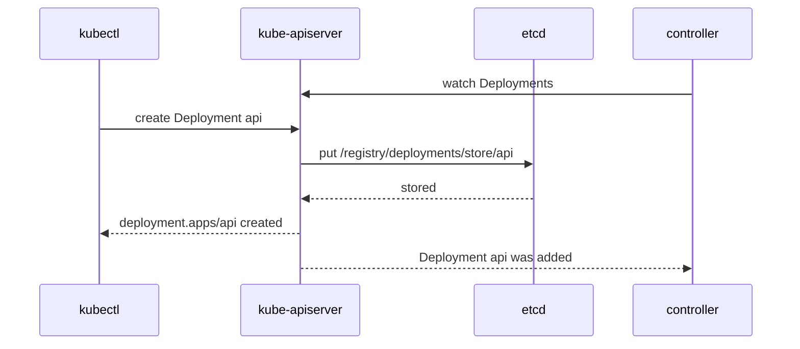
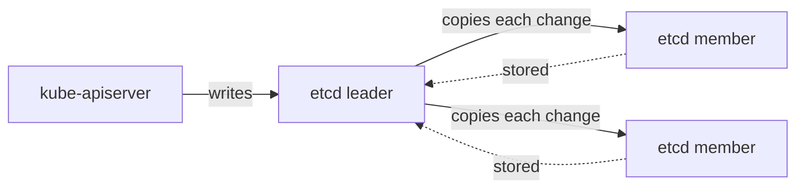

# etcd basics

Every object in a cluster, from a pod to a Role, exists only as an entry in etcd, a key-value store that Kubernetes uses for all its data. It keeps every copy of the data in agreement, and keeps working when some of its machines fail ([operating etcd clusters](https://kubernetes.io/docs/tasks/administer-cluster/configure-upgrade-etcd/)). Lose etcd's data and the cluster forgets every object it had, so etcd is what you back up.

Without etcd, each component would have to store the state it cares about and agree with the others on it. With etcd, there is one record that every change goes into and every component reads from, through the apiserver, the part of the control plane that every request goes through.

## Keys and watches

The apiserver is the only Kubernetes component that talks to etcd. It checks each request, then writes the object to etcd under a key built from its type, namespace and name, such as `/registry/deployments/store/api` for the Deployment `api` in `store`, or `/registry/namespaces/store` for the namespace itself. The value is the object in a compact binary encoding, not the YAML you wrote.

The other components never read etcd: the controllers, which keep objects matching what was asked for, the scheduler, which picks a node for each new pod, and the kubelets, which run the pods on each node. They watch the apiserver, which sends them each change to the objects they follow as it happens ([efficient detection of changes](https://kubernetes.io/docs/reference/using-api/api-concepts/#efficient-detection-of-changes)):

etcd runs as a cluster of members, each with a full copy of the data. One member is the leader, which sends every change to the others and sends them regular heartbeats ([operating etcd clusters](https://kubernetes.io/docs/tasks/administer-cluster/configure-upgrade-etcd/#before-you-begin)). A change counts as stored once a majority of members, called the quorum, have it. The quorum is more than half the members, so 3 members keep working with 1 down, and 5 with 2 down. An even number adds no tolerance: 4 members still survive only 1 failure. This is why the docs say to run an odd number of members, and recommend five in production ([multi-node etcd cluster](https://kubernetes.io/docs/tasks/administer-cluster/configure-upgrade-etcd/#multi-node-etcd-cluster)).

Members talk to each other on port 2380 and to clients on port 2379, both over TLS, the encryption HTTPS uses. Their certificates are signed by etcd's own CA, the certificate authority that vouches for them ([securing etcd clusters](https://kubernetes.io/docs/tasks/administer-cluster/configure-upgrade-etcd/#securing-etcd-clusters), [TLS basics](tls.md)).

## Topology and backups

kubeadm, the tool that builds a cluster, runs one etcd member on each control plane node, next to the apiserver. Each member is a static pod, a pod the kubelet starts from a file on the machine. This is the stacked topology, the kubeadm default. Losing a node then costs both an etcd member and a control plane instance. A highly available cluster, one that keeps working when a control plane node fails, needs at least three control plane nodes ([stacked etcd topology](https://kubernetes.io/docs/setup/production-environment/tools/kubeadm/ha-topology/#stacked-etcd-topology)). The other choice, external etcd, runs the members on machines of their own, which needs twice as many machines ([external etcd topology](https://kubernetes.io/docs/setup/production-environment/tools/kubeadm/ha-topology/#external-etcd-topology)). A single control plane node, as kubeadm builds by default, has a single member, which is its own leader.

etcd holds objects, not what they point to. Container images, the files in volumes and container logs live on the nodes and in storage systems, so an etcd backup brings back every object but none of that data. A backup is a snapshot of the whole key space taken with `etcdctl`, etcd's command-line client ([backing up an etcd cluster](https://kubernetes.io/docs/tasks/administer-cluster/configure-upgrade-etcd/#backing-up-an-etcd-cluster)), and restoring it puts the cluster back to the moment of the snapshot.

The etcd pod and the other control plane components are on the [control plane reference page](../references/control-plane.md#components), and etcd's certificate files are on the [certificates reference page](../references/certificates.md#kubeadms-certificates).

## Further reading

- [Operating etcd clusters for Kubernetes](https://kubernetes.io/docs/tasks/administer-cluster/configure-upgrade-etcd/)
- [Options for highly available topology](https://kubernetes.io/docs/setup/production-environment/tools/kubeadm/ha-topology/)
- [Kubernetes API concepts](https://kubernetes.io/docs/reference/using-api/api-concepts/)
- [etcd FAQ](https://etcd.io/docs/v3.6/faq/), which explains quorum and failure tolerance (not available in the exam)
