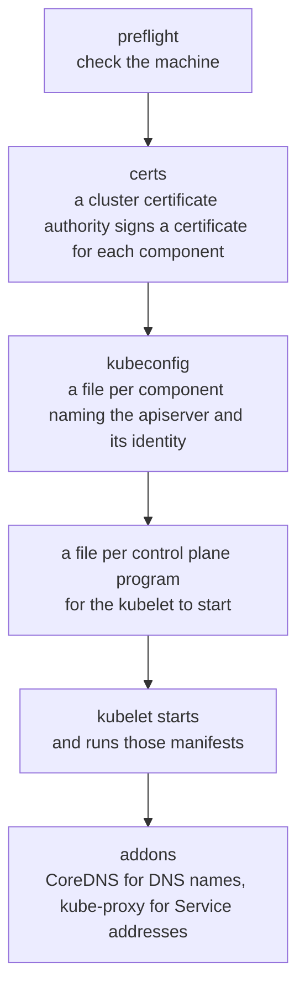
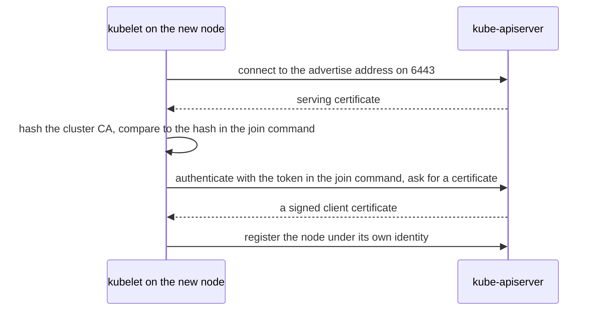

# How kubeadm builds a cluster

kubeadm is the tool that turns a few machines into a Kubernetes cluster. Each machine must already have a container runtime, the program that starts containers, and a kubelet, the agent that runs pods on a machine ([kubeadm init](https://kubernetes.io/docs/reference/setup-tools/kubeadm/kubeadm-init/)). The programs alone are not a cluster. The apiserver, the control plane's front door, is what every other part talks to, and each part needs two things before it will: a certificate, a signed file that proves who it is, and a kubeconfig, a file that says where the apiserver is. The control plane also needs a way to start before any apiserver exists to start it. kubeadm sets all of that up.

## Building the control plane

`kubeadm init` runs on the machine that becomes the control plane, in a fixed order where each step depends on the one before ([init workflow](https://kubernetes.io/docs/reference/setup-tools/kubeadm/kubeadm-init/#init-workflow)):

Certificates come first because everything after them uses them. The cluster CA, a certificate authority that kubeadm creates, signs a certificate for every component. A component trusts another one when its certificate was signed by that CA. The apiserver's own certificate lists every address it answers on. A client that connects on any other address refuses the connection. So kubeadm asks up front for the advertise address, the address the apiserver tells other machines to reach it on, and changing it later means building the control plane again.

The control plane components are written as static pod manifests, files the kubelet reads straight from disk, so they start without an apiserver to ask ([how a cluster works](cluster-architecture.md#how-the-control-plane-starts-itself)).

## Joining a node

A new node and the control plane start with no trust in either direction. The join command carries the CA hash, which lets the node check the cluster, and a bootstrap token, which lets the cluster accept the node ([TLS bootstrapping](https://kubernetes.io/docs/reference/access-authn-authz/kubelet-tls-bootstrapping/)):

The CA hash lets the node check that it reached the right cluster, and anyone may see it. The bootstrap token is the secret part: it lets the apiserver accept the node for long enough to sign it a certificate ([bootstrap tokens](https://kubernetes.io/docs/reference/access-authn-authz/bootstrap-tokens/)). After the join, the node proves who it is with its own certificate, and the token is no longer needed.

## What kubeadm leaves out

kubeadm builds the cluster on machines you provide. It doesn't create the machines or install their container runtime and kubelet, and add-ons such as a dashboard or monitoring are out of its scope ([kubeadm overview](https://kubernetes.io/docs/reference/setup-tools/kubeadm/)).

It also installs no pod network, the plugin that gives pods addresses and lets them reach each other across nodes, because clusters choose different ones. So a new cluster's nodes stay `NotReady` until you install one ([how the pod network works](pod-network.md)).

The [kubeadm](../references/kubeadm.md) reference has the phases, files, commands and errors, and the [workers](../references/workers.md#joining) reference has the join.

## Further reading

- [Creating a cluster with kubeadm](https://kubernetes.io/docs/setup/production-environment/tools/kubeadm/create-cluster-kubeadm/)
- [kubeadm implementation details](https://kubernetes.io/docs/reference/setup-tools/kubeadm/implementation-details/)
- [PKI certificates and requirements](https://kubernetes.io/docs/setup/best-practices/certificates/)
- [TLS bootstrapping](https://kubernetes.io/docs/reference/access-authn-authz/kubelet-tls-bootstrapping/)
